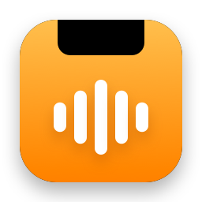
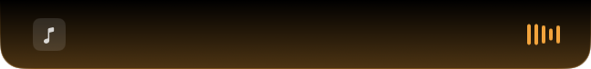
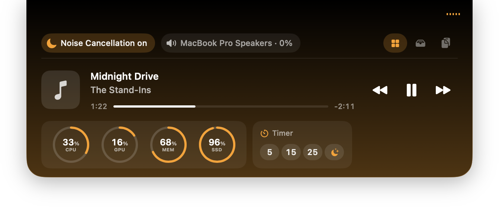
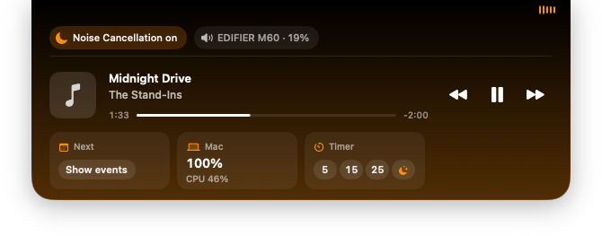
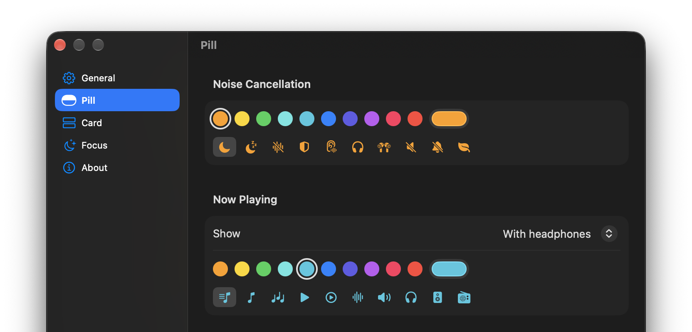

<p align="center">
  
</p>

<h1 align="center">NotchANC</h1>

<p align="center">
  See at a glance when your AirPods are blocking out the world.<br>
  A small pill around your MacBook's notch or Dynamic Island, with what's playing and a card of things worth a glance.
</p>

<p align="center">
  <a href="https://github.com/nyintosh/notchanc/releases/latest"><b>Download the latest release</b></a>
  · macOS 14.2 or later · Free and open source
</p>

---

## What it does

When your AirPods switch to **Noise Cancellation**, a black pill appears around the notch, washed in the colour you chose, with a moon icon or the playing app's icon. When they switch back to Transparency or Off, it fades away.

<p align="center">
  
</p>

Hover it and it opens into one card. On top, the listening mode and where sound is going. Then the player: the playing app's icon, the title and artist, a progress bar, and previous, play/pause and next. Under it, tiles worth a glance: your next event, how busy the Mac is, a quick timer. Tabs on the right switch to a shelf for files and to your recent copies. The pill's icons travel into the card, so the two read as one piece.

<p align="center">
  
</p>

On displays without a notch, such as an external monitor, the pill sits centred in the menu bar with the track's name, as wide as it needs. Hovering opens the same card.

<p align="center">
  
  <br>
  
</p>

### Features

- **Automatic.** NotchANC follows your AirPods' listening mode with no setup and nothing to pair. The card names the mode you're in: Noise Cancellation, Transparency or Adaptive.
- **Now Playing.** Shows the track from any app: music, videos in a browser, podcasts. Hover to open a card with the status (Noise Cancellation, where sound is going) and the player: pause, skip or go back. The status row also shows your headphones' battery. Tiles under the player show your next calendar event and how busy the Mac is (processor, graphics, memory, disk), and start a quick timer or a focus session. Two more tabs hold a shelf for files you drag onto the pill and the last things you copied, both searchable, with pins for the copies you want to keep. ⌃⌥V and ⌃⌥F open them from any app, keyboard only: type to search, ↑ and ↓ to choose, Return to copy or open. Click the track to jump to the app, or the browser tab, that's playing it.
- **A live visualizer.** The bars beside the notch move with the sound that's playing.
- **Media without ANC.** With Noise Cancellation off, the pill takes the Now Playing colour and shows the playing app's icon while audio plays through headphones (AirPods, any Bluetooth headset, or the headphone jack). In Settings › Pill, choose instead to show it for sound from any output, to keep it always visible, or to never show it.
- **Notch, Dynamic Island or neither.** Sizes itself to the camera cutout on notch MacBooks and on the MacBook Pro with Dynamic Island. Choose which displays show it.
- **Stays out of the way.** Clicks pass through to the menu bar. Behind full-screen apps on external displays it hides. Clicking it never brings NotchANC to the front; only its search field takes the keyboard, and gives it back when the card closes.
- **Right-click the pill** for Settings, Check for Updates and Quit.
- **Hide the menu bar icon** if you prefer. Open NotchANC again to bring up Settings.
- **Make it yours.** Pick the colour (any colour) and icon for each state, choose the menu bar icon, choose when the Now Playing pill shows, turn each tile and tab of the card on or off, change the keyboard shortcuts, set the timer's lengths, open at login, and get automatic updates.

<p align="center">
  
  
</p>

## Install

1. Download `NotchANC-x.y.z.dmg` from [Releases](https://github.com/nyintosh/notchanc/releases/latest).
2. Open it and drag **NotchANC** into **Applications**.
3. Launch it. A pair of AirPods appears in your menu bar.
4. Allow **Bluetooth** access when macOS asks. NotchANC uses it only to notice when your headphones disconnect.
5. Allow **System Audio Recording** when macOS asks. NotchANC uses it only to move the visualizer while something plays. The sound stays on your Mac and is never recorded.
6. The first time you click a track playing in a browser, allow NotchANC to control that browser. It only switches to the playing tab.
7. To see your next event in the card, press **Show events** on its tile and allow **Calendar** access. NotchANC only reads it, and never asks unless you press that button.

The app is signed with a Developer ID and notarized by Apple, so it opens without Gatekeeper warnings. It checks GitHub for updates and installs them from **Check for Updates…**.

## How it works

macOS has no public API for any of this, so NotchANC combines what the system already exposes.

| Question | Where the answer comes from |
|---|---|
| Is Noise Cancellation on? | The Bluetooth daemon logs every listening-mode change, for example `LsnM ANC`. NotchANC reads it with Apple's `log` tool: the last 30 minutes at launch, then a live stream. |
| What's playing? | macOS 15.4 and later only let Apple's own processes read Now Playing. NotchANC asks Apple's `osascript` to read it once a second and report only changes, and to send play/pause, next and previous. Clicking the track asks the browser over AppleScript for the tab whose title holds it. |
| How loud is it? | A Core Audio process tap hears the Mac's output while the pill shows something playing. NotchANC splits it into five frequency bands for the bars and keeps nothing. |
| Where is sound going? | Core Audio reports the current output's name and volume, whether it is Bluetooth or the headphone jack, and notifies when any of that changes. |
| How charged are the headphones? | No API gives AirPods battery levels, so NotchANC reads them from the Bluetooth section of Apple's `system_profiler` report while the card is open. |
| How busy is the Mac? | The kernel reports processor and memory use and the startup disk reports its space. Graphics use comes from the figures the graphics driver publishes in the I/O Registry. |
| What's next on the calendar? | EventKit, for the next timed event in the coming day, once you have allowed it. |
| What was copied? | The pasteboard has no change notice, so NotchANC checks its counter twice a second and keeps the last ten texts in memory. |
| Where's the notch or island? | `NSScreen` reports the camera cutout as a top safe-area inset plus the free areas to its left and right. The pill hugs whatever gap they leave, so it fits notches and the Dynamic Island alike. |

The pill is a borderless, non-activating window at menu bar level. It ignores the mouse unless the pointer is on it, so you can still use the menu bar underneath.

These sources are undocumented and may change with a macOS update. If one stops working, NotchANC keeps running and simply shows less.

## Privacy

- Everything stays on your Mac. NotchANC has no analytics, no accounts and no servers.
- Its only network traffic is the update check, which fetches [`appcast.xml`](appcast.xml) from this repository.
- From the system it reads the Bluetooth daemon's listening-mode lines in the log, the title and artist of what's playing, your headphones' battery level, how busy the Mac is, and, only if you allow it, your next calendar event.
- The clipboard history holds the last ten texts you copied, in memory only: it is gone when NotchANC quits, and anything a password manager marks as secret is never kept. A copy you pin is saved with your settings until you unpin it. Turn the history off in Settings › Card.
- The shelf remembers the paths of the files you dropped on it, nothing of their contents.
- A focus session runs a Shortcut only if you picked one in Settings › Focus.
- It stores nothing but your settings, the shelf's paths and the copies you pinned.

## Scripting

Other tools can turn the pill on or off with a distributed notification:

```swift
DistributedNotificationCenter.default().postNotificationName(.init("notchanc.set"), object: "on", deliverImmediately: true)
```

While **Automatic** is on, the next AirPods mode change overrides the manual state.

## Building from source

Requires Xcode 27. The only dependency is [Sparkle](https://sparkle-project.org), fetched by Swift Package Manager.

```sh
git clone https://github.com/nyintosh/notchanc.git
cd notchanc
xcodebuild -scheme NotchANC -derivedDataPath build/test test   # unit tests
open NotchANC.xcodeproj                                          # or build and run in Xcode
```

| Path | What's in it |
|---|---|
| `NotchANC/App.swift` | Menu bar item, menu, and the logic that decides when the pill shows |
| `NotchANC/Overlay.swift` | Pill layout (unit-tested), the pill and its card, hover and animation |
| `NotchANC/AirPodsMonitor.swift` | Reads the listening mode from the system log |
| `NotchANC/NowPlaying.swift` | Reads Now Playing through `osascript` |
| `NotchANC/AudioOutput.swift` | Watches where sound goes: the device, its volume, headphones or not |
| `NotchANC/AudioTap.swift` | Hears the Mac's output for the visualizer |
| `NotchANC/Glance.swift` | Reads headphone battery, the next event and how busy the Mac is |
| `NotchANC/Countdown.swift` | The quick timer and the focus session |
| `NotchANC/Shelf.swift` | Files parked on the pill |
| `NotchANC/Clipboard.swift` | The recent and pinned copies |
| `NotchANC/Hotkeys.swift` | The global keyboard shortcuts |
| `NotchANC/Settings.swift` | The Settings window |
| `tools/icon.swift` | Draws the app icon |
| `tools/release.sh` | Builds, signs, notarizes and publishes a release |

`tools/release.sh` needs the maintainer's Developer ID certificate, App Store Connect API key (`ASC_KEY` path, `ASC_ID`, `ASC_ISSUER` in the environment) and Sparkle signing key, so forks should change the team, feed URL and keys first. [docs/development.md](docs/development.md) explains how the parts fit.

## Changelog

See [CHANGELOG.md](CHANGELOG.md).

## License

[MIT](LICENSE) © 2026 Nyi Nyi Htun
