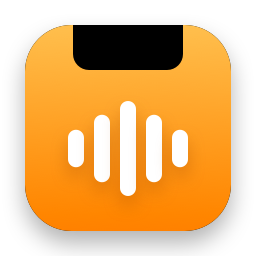
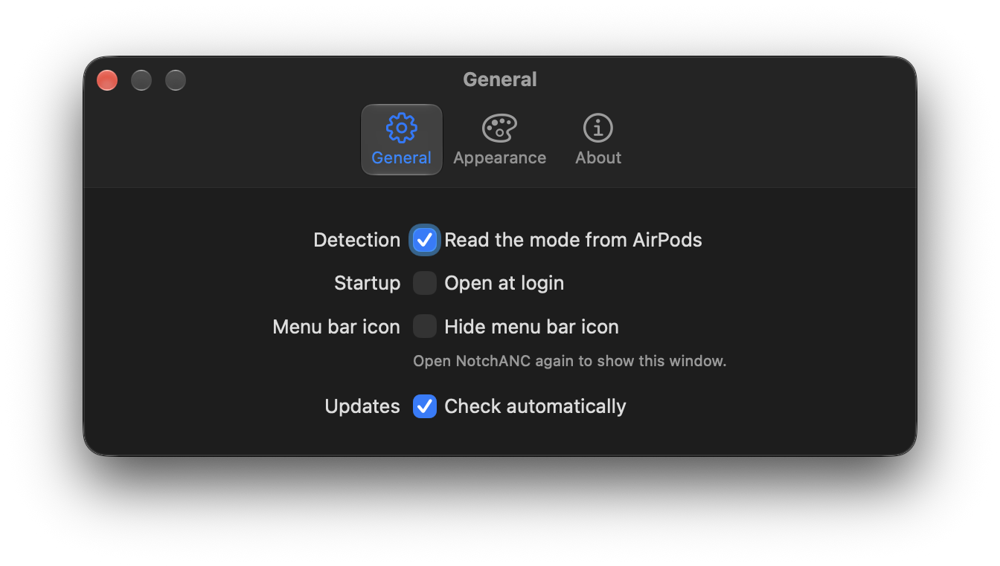
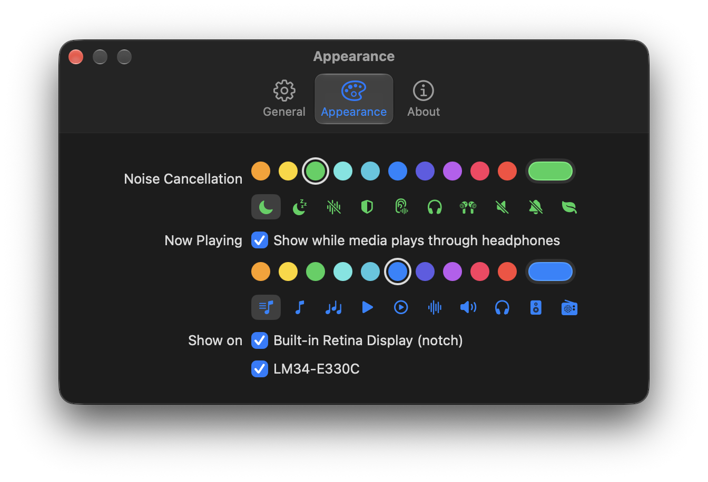

<p align="center">
  
</p>

<h1 align="center">NotchANC</h1>

<p align="center">
  See at a glance when your AirPods are blocking out the world.<br>
  A small pill around your MacBook's notch or Dynamic Island, plus what's playing.
</p>

<p align="center">
  <a href="https://github.com/nyintosh/notchanc/releases/latest"><b>Download the latest release</b></a>
  · macOS 14 or later · Free and open source
</p>

---

## What it does

When your AirPods switch to **Noise Cancellation**, a black pill appears around the notch with a moon icon. When they switch back to Transparency or Off, it fades away.

<p align="center">
  
</p>

Hover it and it slides open. Noise Cancellation is on the left and what you're playing is on the right.

<p align="center">
  
</p>

On displays without a notch, such as an external monitor, the pill sits centred in the menu bar and scrolls instead. Hovering swaps in the current track.

<p align="center">
  
  <br>
  
</p>

### Features

- **Automatic.** NotchANC follows your AirPods' listening mode with no setup and nothing to pair.
- **Now Playing.** Shows the track from any app: Music, Spotify, YouTube in a browser, podcasts. The waveform moves only while something plays.
- **Media without ANC.** With Noise Cancellation off, the pill turns blue with a music icon while audio plays through headphones (AirPods, any Bluetooth headset, or the headphone jack). It stays hidden when sound comes from the speakers.
- **Notch, Dynamic Island or neither.** Sizes itself to the camera cutout on notch MacBooks and on the MacBook Pro with Dynamic Island. Choose which displays show it.
- **Stays out of the way.** Clicks pass through to the menu bar. Behind full-screen apps on external displays it hides. Clicking it never steals focus.
- **Right-click the pill** for Settings, Check for Updates and Quit.
- **Hide the menu bar icon** if you prefer. Open NotchANC again to bring up Settings.
- **Make it yours.** Pick the colour (any colour) and icon for each state, turn the Now Playing pill off, open at login, and get automatic updates.

<p align="center">
  
  
</p>

## Install

1. Download `NotchANC-x.y.z.dmg` from [Releases](https://github.com/nyintosh/notchanc/releases/latest).
2. Open it and drag **NotchANC** into **Applications**.
3. Launch it. A pair of AirPods appears in your menu bar.
4. Allow **Bluetooth** access when macOS asks. NotchANC uses it only to notice when your headphones disconnect.

The app is signed with a Developer ID and notarized by Apple, so it opens without Gatekeeper warnings. It checks GitHub for updates and installs them from **Check for Updates…**.

## How it works

macOS has no public API for any of this, so NotchANC combines what the system already exposes.

| Question | Where the answer comes from |
|---|---|
| Is Noise Cancellation on? | The Bluetooth daemon logs every listening-mode change, for example `LsnM ANC`. NotchANC reads it with Apple's `log` tool: the last 30 minutes at launch, then a live stream. |
| What's playing? | macOS 15.4 and later only let Apple's own processes read Now Playing. NotchANC asks Apple's `osascript` to read it once a second and report only changes. |
| Are headphones in use? | Core Audio reports whether the current output is Bluetooth or the headphone jack, and notifies when that changes. |
| Where's the notch or island? | `NSScreen` reports the camera cutout as a top safe-area inset plus the free areas to its left and right. The pill hugs whatever gap they leave, so it fits notches and the Dynamic Island alike. |

The pill is a borderless, non-activating window at menu bar level. It ignores the mouse unless the pointer is on it, so you can still use the menu bar underneath.

These sources are undocumented and may change with a macOS update. If one stops working, NotchANC keeps running and simply shows less.

## Privacy

- Everything stays on your Mac. NotchANC has no analytics, no accounts and no servers.
- Its only network traffic is the update check, which fetches [`appcast.xml`](appcast.xml) from this repository.
- It reads only the Bluetooth daemon's listening-mode lines from the system log, and the title and artist of what's playing. It stores nothing but your settings.

## Scripting

Other tools can turn the pill on or off with a distributed notification:

```swift
DistributedNotificationCenter.default().postNotificationName(.init("notchanc.set"), object: "on", deliverImmediately: true)
```

While **Automatic** is on, the next AirPods mode change overrides the manual state.

## Building from source

Requires Xcode 27. The only dependency is [Sparkle](https://sparkle-project.org), fetched by Swift Package Manager.

```sh
git clone https://github.com/nyintosh/notchanc.git
cd notchanc
xcodebuild -scheme NotchANC -derivedDataPath build/test test   # unit tests
open NotchANC.xcodeproj                                          # or build and run in Xcode
```

| Path | What's in it |
|---|---|
| `NotchANC/App.swift` | Menu bar item, menu, and the logic that decides when the pill shows |
| `NotchANC/Overlay.swift` | Pill layout (unit-tested) and drawing, hover and animation |
| `NotchANC/AirPodsMonitor.swift` | Reads the listening mode from the system log |
| `NotchANC/NowPlaying.swift` | Reads Now Playing through `osascript` |
| `NotchANC/AudioOutput.swift` | Watches whether sound goes to headphones |
| `NotchANC/Settings.swift` | The Settings window |
| `tools/icon.swift` | Draws the app icon |
| `tools/release.sh` | Builds, signs, notarizes and publishes a release |

`tools/release.sh` needs the maintainer's Developer ID certificate, App Store Connect API key and Sparkle signing key, so forks should change the team, feed URL and keys first.

## Changelog

See [CHANGELOG.md](CHANGELOG.md).

## License

[MIT](LICENSE) © 2026 Nyi Nyi Htun
